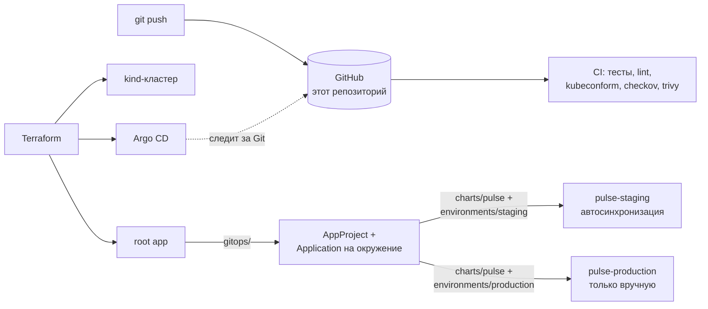

# gitops-platform — Kubernetes + Terraform + Argo CD

[](https://github.com/tob1s3/gitops-platform/actions/workflows/ci.yml)

Учебная, но полноценная платформа доставки сервиса в Kubernetes по модели GitOps:

- **Terraform** поднимает кластер (kind) и устанавливает Argo CD;
- **Argo CD** забирает из Git описание окружений и сам приводит кластер к нему;
- **Helm-чарт** описывает сервис с production-настройками: пробы, HPA, PDB, NetworkPolicy, Pod Security «restricted»;
- **CI** проверяет всё статически и прогоняет e2e: настоящий кластер, настоящий Argo CD, выкатка из проверяемого коммита.



## Что внутри

```text
app/                    сервис pulse на Go (только стандартная библиотека) + Dockerfile (distroless, non-root)
charts/pulse/           Helm-чарт сервиса + values.schema.json
environments/
  staging/values.yaml   отличия staging от значений по умолчанию
  production/values.yaml
gitops/                 app of apps: AppProject и Application для каждого окружения
terraform/              kind + Argo CD + корневое приложение
scripts/
  validate-chart.sh     lint, рендер окружений, kubeconform, отрицательные тесты
  e2e-check.sh          проверки в живом кластере
```

### Сервис pulse

Небольшой HTTP-сервис, на котором видно, что нужно приложению, чтобы нормально жить в Kubernetes:

- `/healthz` — liveness. Не проверяет зависимости, иначе сбой базы перезапустил бы все поды разом;
- `/readyz` — readiness. После SIGTERM сразу отвечает 503;
- **корректное завершение:** SIGTERM → под перестаёт быть ready → пауза `SHUTDOWN_DELAY`, пока kube-proxy и Ingress
  уберут его из балансировки → `Shutdown` дожидается активных запросов. Rolling update проходит без ошибок у клиентов;
- `/metrics` — метрики Prometheus (счётчик запросов, гистограмма задержек, build info). В метки идёт шаблон маршрута,
  а не URL, поэтому сканер с тысячей случайных путей не раздует TSDB;
- `GOMEMLIMIT` берётся из `limits.memory` контейнера: сборщик мусора Go учитывает лимит, и под не убивается по OOM.

Тесты (`go test -race`) проверяют маршруты, метрики и переключение readiness при остановке. Ещё один тест убеждается,
что остановка дожидается запроса, который уже обрабатывается.

### Helm-чарт

| Что | Зачем |
|---|---|
| `runAsNonRoot`, `readOnlyRootFilesystem`, `drop: [ALL]`, `seccompProfile: RuntimeDefault` | проходит Pod Security Standard «restricted» |
| `automountServiceAccountToken: false` | сервису не нужен API Kubernetes — токен не попадает в под |
| startup/liveness/readiness-пробы | под получает трафик только когда готов |
| `maxUnavailable: 0`, `maxSurge: 1` | обновление без потери ёмкости |
| PodDisruptionBudget | drain узла не выключит все реплики сразу |
| topologySpreadConstraints | реплики разнесены по узлам и зонам |
| HPA (autoscaling/v2) с медленным масштабированием вниз | без «пилы» числа реплик |
| NetworkPolicy | входящий трафик — только от Ingress, Prometheus и своего релиза; исходящий — только DNS |
| ServiceMonitor, Ingress | включаются флагами |
| образ по digest | в production тег можно заменить на неизменяемый digest |
| `values.schema.json` | опечатка в values (`replicaCont`, `pullPolicy: Sometimes`, неверный digest) — ошибка при рендере, а не тихо проигнорированное поле |

CPU-лимиты не задаются намеренно: они вызывают throttling даже при свободном процессоре. Память ограничена.
Осознанные исключения из проверок checkov записаны в [`.checkov.yaml`](.checkov.yaml) с причинами.

### GitOps-модель

- Корневое приложение (его создаёт Terraform) смотрит на `gitops/`. Оттуда Argo CD создаёт `AppProject` и по одному
  `Application` на каждое окружение — паттерн app of apps.
- **staging** синхронизируется автоматически, с `prune` и `selfHeal`: ручная правка в кластере откатывается к состоянию из Git.
- **production** только показывает расхождение. Выкатка — вручную (`argocd app sync pulse-production` или кнопка в UI).
  Это и есть promotion gate.
- `AppProject` ограничивает Argo CD: только этот репозиторий, только namespace `pulse-*`, только перечисленные типы
  ресурсов. Из ресурсов уровня кластера разрешён лишь Namespace.
- Namespace создаётся с метками Pod Security `enforce: restricted`.

Чтобы добавить окружение, достаточно добавить папку в `environments/` и строку в `gitops/values.yaml`.

## CI

| Job | Что проверяет |
|---|---|
| `app` | gofmt, go vet, тесты с race detector, govulncheck |
| `chart` | `helm lint --strict`, рендер каждого окружения, kubeconform по схемам Kubernetes и CRD Argo CD, отрицательные тесты схемы values, checkov |
| `terraform` | fmt, validate, checkov |
| `image` | сборка образа, Trivy (HIGH/CRITICAL роняют сборку); на `main` — публикация в GHCR |
| `e2e` | `terraform apply` → kind (1 control plane + 2 worker) + Argo CD → Argo CD выкатывает staging **из проверяемого коммита** → проверки ниже → `terraform destroy` |

Что проверяет e2e ([`scripts/e2e-check.sh`](scripts/e2e-check.sh)):

1. Корневое приложение создало оба Application, staging в состоянии `Synced` и `Healthy`.
2. Namespace создан с политикой Pod Security `restricted`, и поды её проходят.
3. Сервис отвечает через Service, метрики отдаются.
4. **Self-heal:** `kubectl scale --replicas=1` откатывается Argo CD обратно к 2.
5. **Promotion gate:** production остаётся `OutOfSync`, и в кластере его нет.

Все actions закреплены по SHA коммита, у `GITHUB_TOKEN` по умолчанию права только на чтение, обновления приносит Dependabot.

## Запуск локально

Нужны Docker, Terraform ≥ 1.6 (или OpenTofu), kubectl, Helm.

```bash
make test        # тесты сервиса
make validate    # чарты и terraform без кластера
make up          # kind + Argo CD + приложения (образ собирается локально и загружается в kind)
make argocd-ui   # http://localhost:8080
make down
```

По умолчанию Argo CD берёт манифесты из `https://github.com/tob1s3/gitops-platform.git`, ветка `main`.
Для своего форка: `terraform apply -var repo_url=... -var git_revision=...`.

> Если провайдеры не скачиваются с `registry.terraform.io` (в России он недоступен), используйте зеркало,
> например `terraform-mirror.yandexcloud.net`, через `provider_installation` в `~/.terraformrc`. Конфигурация
> совместима с OpenTofu.

## Как это проверялось при разработке

- Сервис: `go vet`, `go test -race` (покрытие 83 %), ручная проверка SIGTERM: readiness 503 → пауза → закрытие порта.
- Чарты: `helm lint --strict` и `helm template` (Helm 4.3), kubeconform по схемам Kubernetes 1.33 и CRD Argo CD,
  checkov — 347 проверок без замечаний, 7 отрицательных тестов схемы.
- Terraform: `fmt` и `validate` с провайдерами kind 0.13 и helm 3.3; значения корневого приложения вычислены Terraform, отрендерены чартом argocd-apps и проверены kubeconform.
- e2e выполняется в GitHub Actions: для него нужен Docker с kind.

## Ограничения

- Локальный стенд использует kind; для облака нужен другой модуль кластера (например, Yandex Managed Service for
  Kubernetes). Остальное — Argo CD, чарт, окружения — не меняется.
- `.terraform.lock.hcl` не закоммичен: его нужно сгенерировать командой
  `terraform providers lock -platform=linux_amd64 -platform=darwin_arm64` из официального реестра или зеркала.
- Обновление тега образа в `environments/*` пока делается коммитом вручную; следующий шаг — Argo CD Image Updater
  или PR от CI.

## Лицензия

MIT
